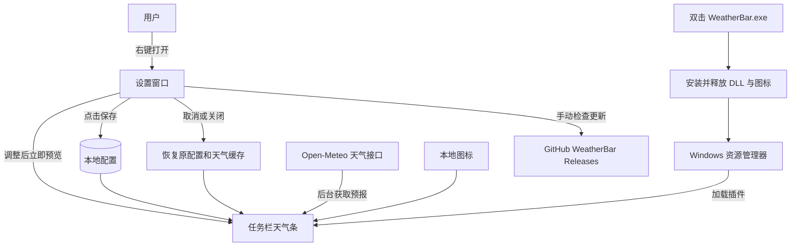

# WeatherBar 架构

任务栏组件由资源管理器加载。设置预览只影响内存，保存才原子写入配置；取消同时恢复配置及天气缓存。后台请求带代次，切换地点后不会把过期结果覆盖到新地点。

- `src/DeskBand.*`：任务栏显示、资源复用、预览快照和还原。
- `src/Settings.cpp`：多语言布局、调色盘、即时预览和保存/取消。
- `src/ImportConfig.*`：XML 配置、字段默认值、旧版本迁移及写入保护。
- `src/Weather.*`：天气获取、解析、缓存和调度。
- `src/Update.*`：手动检查正式版本，不自动下载。
- `launcher/`：单 EXE 打包、当前用户安装和安全卸载。
- `tests/`：直接验证正式实现的回归测试，无第三方测试框架。

沿用现有原生 Win32/COM 和 v145 工程，不引入主题系统、地理数据库、城市搜索或浏览器 UI 框架。目录只保留参与构建的工程；构建产物、个人配置、调试缓存和历史过程报告不提交。

## 1.1 三天天气与悬停

明天天气和后天天气各有独立开关，整体控制日期、天气文字及最低温 / 最高温；新安装默认均关闭。配置格式升级为 3：旧“今日最高/最低”悬停开关开启时迁移为两天均开启，关闭或不存在则均关闭；新版独立选择保留，迁移前保留原件备份。任务栏今日高低温不变。

天气文字直接来自 Open-Meteo 每日 weather_code（当天最严重现象），是单一天气摘要，不描述天气变化过程。毛毛雨和阵雨归为雨，冻毛毛雨归为冻雨，米雪和阵雪归为雪，伴冰雹雷暴归为雷暴；各类不区分强度。未知或缺失代码显示“天气未知”。按配置地点的当地日期匹配三天数据，缺失温度各自显示 `--`，不借用其他日期。用户自定义请求返回天数不足时保留缺失状态。

每个日期独立一行，始终按“最低温 / 最高温”排序，例如 `明天：多云 13℃ / 22℃`。按提示字体实际宽度测量，空间不足时日期与内容分两行，两天之间不加空白行。字段沿用现有请求、缓存、失败状态与刷新周期，不增加请求。

应用版本为 1.1，配置格式版本为 3。位 0 表示明天、位 7 表示后天，位 1–6 保持原含义；只有旧格式会迁移位 0。保存、取消、关闭仍通过完整 BandConfig 和 ForecastCache 快照处理。
