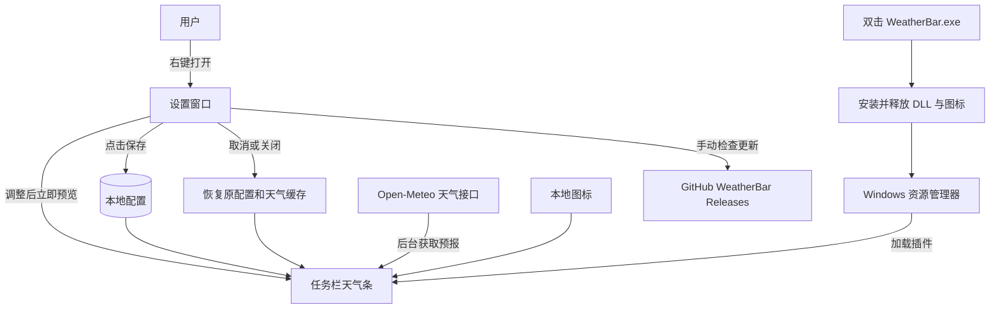

# WeatherBar 架构

任务栏组件由资源管理器加载。设置预览只影响内存，保存才原子写入配置；取消同时恢复配置及天气缓存。后台请求带代次，切换地点后不会把过期结果覆盖到新地点。

- `src/DeskBand.*`：任务栏显示、资源复用、预览快照和还原。
- `src/Settings.cpp`：多语言布局、调色盘、即时预览和保存/取消。
- `src/ImportConfig.*`：XML 配置、字段默认值、旧版本迁移及原子写入保护。
- `src/Weather.*`：天气获取、解析、缓存和调度。
- `src/Update.*`：手动检查正式版本，不自动下载。
- `launcher/`：单 EXE 打包、当前用户安装和安全卸载。
- `tests/`：直接验证正式实现的回归测试，无第三方测试框架。

沿用现有原生 Win32/COM 和 v145 工程，地点搜索复用Open-Meteo，不引入主题系统、全球地理数据库或浏览器UI框架。目录只保留参与构建的工程；构建产物、个人配置、调试缓存和历史过程报告不提交。

## 1.1 三天天气与悬停

明天天气和后天天气各有独立开关，整体控制日期、天气文字及最低温 / 最高温；新安装默认均开启。以配置格式3为一次性兼容迁移分界：旧“今日最高/最低”悬停开关开启时迁移为两天均开启，明确关闭则均关闭，缺失条目使用当前默认值；新版独立选择保留，迁移不生成额外备份文件，原子保存失败时保留原配置。任务栏今日高低温不变。

天气文字直接来自 Open-Meteo 每日 weather_code（当天最严重现象），是单一天气摘要，不描述天气变化过程。毛毛雨和阵雨归为雨，冻毛毛雨归为冻雨，米雪和阵雪归为雪，伴冰雹雷暴归为雷暴；各类不区分强度。未知或缺失代码显示“天气未知”。按配置地点的当地日期匹配三天数据，缺失温度各自显示 `--`，不借用其他日期。用户自定义请求返回天数不足时保留缺失状态。

每个日期独立一行，始终按“最低温 / 最高温”排序，例如 `明天：多云 13℃ / 22℃`。按提示字体实际宽度测量，空间不足时日期与内容分两行，两天之间不加空白行。字段沿用现有请求、缓存、失败状态与刷新周期，不增加请求。

应用版本为 1.1，当前配置格式版本为 5（未来天气选项最初在格式3引入）。位 0 表示明天、位 7 表示后天，位 1–6 保持原含义；只有旧格式会迁移位 0。保存、取消、关闭仍通过完整 BandConfig 和 ForecastCache 快照处理。

## 地点选择与自动时区（应用1.1，配置格式5）

- `Location.h/.cpp`：短国家表、WGS84校验及共享后台搜索/天气验证请求；原生地点控件和候选列表由Settings.cpp管理。共享请求对象配合 acquire/release 完成标记，窗口/输入变化通过丢弃对象拒绝旧响应，不把临时结果落盘。
- `ServiceJson.h`：Windows 自带 Windows.Data.Json，用于搜索 Unicode/转义、结构和天气时区元数据验证，无第三方 JSON 库。后台线程持有 ModuleReference，窗口关闭不等待网络。
- `Weather.cpp`：搜索复用 WinHTTP GET 的超时、大小和总时限约束；生成与高级地址统一调用 PrepareForecastUrl 补齐字段，不覆盖 forecast_days 等其他参数。普通刷新与首次地点验证共享同一天气解析逻辑。
- `BandConfig`：LocationMode、名称、纬度、经度、IANA时区、国家筛选；旧TimezoneOffset仅兼容读取并丢弃，不再保存或参与运行。格式4引入地点字段，格式5增加None状态；旧有效URL配置按原模式恢复；旧悬停迁移仍仅对格式3之前执行。不生成迁移备份，损坏/未来格式保护和原子写入保持。
- 时间函数参数统一为秒。ForecastCache 保存响应时区和秒偏移，每次成功响应更新；三种来源均在响应时区校验后解析当地日期，不再有手动小时偏移分支。日期、当前小时、日出日落、未来两天、小时唤醒及定时刷新均使用这一单位。
- 首次自动地点应用先获取有效天气及时区，再通过 ApplyPreviewConfig 的已验证缓存入口提交内存预览，避免先清空有效地点。代次拒绝旧天气响应；主设置快照同时恢复配置和缓存。保存成功才落盘。
- IANA 与 Windows 时区ID不同，本次没有加入映射层。最小方案使用响应固定偏移并随刷新更新；不能完整处理单次响应覆盖的DST切换，尤其每日聚合边界。这一限制在三语言 README 中明确说明。

服务文档：https://open-meteo.com/en/docs/geocoding-api 、https://open-meteo.com/en/docs 。地点来源 GeoNames。没有地图、IP/GPS定位、城市数据库或新后台定时任务。

Windows 动态时区转换能力已核对：SystemTimeToTzSpecificLocalTimeEx 接受 DYNAMIC_TIME_ZONE_INFORMATION；若后续需要完整DST，应增加IANA到Windows标识映射，并逐时间点转换/重新审视每日边界，而不是只修改一处偏移。参考：https://learn.microsoft.com/en-us/windows/win32/api/timezoneapi/nf-timezoneapi-systemtimetotzspecificlocaltimeex 。

## 主窗口地点与高级折叠区域

独立地点窗口及专属消息循环已删除。`SettingsState`持有搜索、地点验证和候选状态；输入/国家/语言变化或窗口销毁会丢弃过期共享请求。UI定时器只读取完成标记，不增加天气后台轮询。

`LayoutSettings`按实际字体测量控件与卡片最小宽度，每次从行列关系重新计算全部矩形，不再保存原始绝对坐标或整体平移后续分组。基础卡片占整行；中部按内容最小宽度切换两列/单列，双列按两行内容较大值对齐，单列保持自然高度。高级标题仍为原生owner-draw按钮，收起前先恢复焦点再夹取滚动位置；草稿、折叠状态及配置语义不变。

坐标/URL编辑控件保持各自草稿，方式切换不改变BandConfig。`ReadDraft`只读取外观、国家偏好及已应用地点；原始URL只在“应用地址”时读取。三种来源均通过共享天气解析校验后才更新预览，三种来源统一使用响应时区与秒偏移。保存/取消/关闭继续复用完整配置和缓存快照。

## 基础设置、自动时区与初始化

基础设置将语言放在首行。选址提示是独立SS_CENTERIMAGE单行STATIC，与应用地点同行；搜索、坐标、URL状态独立存放并在各自区域布局。自定义地点设置使用原生owner-draw按钮、加粗标题、轻微底色和边框；两种应用按钮按客户区中心摆放。

ComboWheelProc统一附加到所有组合框及GetComboBoxInfo得到的展开列表，阻止滚轮改变选择；收起时转发至主内容，展开时仅改变列表可见起始项，保留原生鼠标/键盘行为。WM_NCDESTROY移除回调，无递归转发。

DefaultBandConfig返回None状态，所有地点字段和URL留空，国家不限。已有XML继续解析已保存URL/元数据，不套用默认城市。格式5新增None枚举，避免旧程序将空地点误判为默认地址。恢复默认仍只影响外观，应用仍1.1。

Weather的实际请求补齐timezone：正确解析查询键/值边界及百分号编码，空值视为缺失，重复取最后一个非空值，内部合并为一个参数。原始URL不改，无关参数保留。所有生产天气入口都先校验timezone/utc_offset_seconds，再归档小时和每日数据；偏移仅来自成功缓存，首次未获取不使用系统或北京偏移。旧手动偏移仅兼容读取，不再有控件、正常字段或运行分支。现有固定响应范围DST限制保留。

数据来源在关于与更新的入口，原生TaskDialog提供Open-Meteo、GeoNames及CC BY 4.0来源许可链接，并说明简化；不新增网络服务或依赖。

## 未选地点与便携配置恢复

HasConfiguredLocation作为请求、刷新和调度入口的统一条件。空地点是合法可保存状态；首次没有天气请求或TIMER_WAKE，任务栏保留无数据占位，立即刷新禁用，可选数据状态引导进入设置（默认关闭），设置窗口显示未选地点。ApplyPreviewConfig回到None时清除缓存和时区、杀掉定时器，并通过代次拒绝旧预览结果。保留原子保存及损坏/未来格式保护，配置不可读会在设置提示，并在启用数据状态时加入悬停。

配置依旧位于DLL/EXE目录WeatherBar.xml，同目录旧名为兼容后备，不扫描用户磁盘。安装资源释放只更新DLL和缺失图标，不写XML；默认卸载不调用DeleteUserFiles或EXE/空目录清理，故同目录重新安装可恢复。用户删除XML/目录、换账户或无法读取不保证恢复。没有改动安装架构或配置位置。

当前搜索及应用状态使用单行居中STATIC，始终与应用按钮同行，候选列表以固定紧凑高度常驻，不与固定说明叠加；坐标/URL错误留在所属区域。URL、多行输入及真正列表/主窗口的滚动保持，其他下拉框轮滚保护沿用。

## 悬停开关、两种时间与同排搜索

BandConfig保留8位天气字段，默认129（明天/后天）；另加tooltipRefresh=true、tooltipStatus=false，对应XML Refresh/Status。只给缺失字段补默认，已保存的0和独立选择不改。旧格式位迁移继续只执行一次。新增可选字段沿用格式5，不递增应用版本或混用版本号。主开关只抑制显示，子项保留；全空时禁用原生提示并返回空串，拼接不留末尾或空白分隔行。

lastSuccessfulFetch是接受有效响应时的time_t，失败、过期响应、语言及重绘不改。显示通过Windows系统当前时区转换，不使用天气地点偏移或附UTC后缀；未成功为“尚未刷新”。天气日期/小时/日出日落/调度仍用缓存的地点秒偏移。数据状态优先级：配置保护、无地点、更新中、无数据、过期、失败用缓存、正常；关闭不改变操作失败反馈。预览快照继续恢复成功时间及缓存。

国家表固定28项（含不限），按代码保存；国家、地点、搜索同排，保留固定国家/按钮宽度，地点分配剩余宽度。最小宽度随实际内容、语言及DPI计算，默认窗口优先两列且限制在当前显示器工作区；主内容子窗口滚动，底部操作栏固定。单一SS_OWNERDRAW STATIC搜索状态、候选有限高度滚动、URL多行及高级折叠保留。

搜索结果按country_code映射国家名，TW/HK/MO的显示与请求代码分离。配置新增CountryCode/CountryName/Admin，恢复及语言切换重新组合。旧搜索标签只有在已知分隔结构中精确匹配国家组件时才迁移，无法识别的自由文本保留；不会替换整段地址子串。国家列表本地化不改变顺序，不发网络请求；原生下拉列表视口滚动不改选项，点击/键盘正常。

## 动态卡片与固定底栏

只读参考JDM的MainWindow.Settings.cs、ResponsivePanel.cs及light-settings.png，借鉴卡片间距、对齐和自然高度，不复用WPF框架、侧边栏或JDM配置行为。WeatherBar继续使用Win32。

主窗口保留WS_THICKFRAME、WS_CAPTION、WS_SYSMENU，移除最小化/最大化样式。内容使用WS_EX_CONTROLPARENT的原生子窗口，唯一页面滚动条属于该子窗口，可视高度为主客户区减固定64 DIP操作栏。子窗口天然裁剪内容；恢复默认、保存、取消直接属于主窗口，不进入内容滚动范围。SettingsControl/SettingsMessage只负责两层控件查找，子窗口转发原有业务消息，Tab导航从主窗口进入内容再进入底栏。

MeasureSettingsLanguage用真实字体分别测量中英日标签、三语言按钮分组与国家选项；MeasureSettings取三种语言single/doubleColumn最大值，作为不随界面语言变化的共同要求。短按钮和普通按钮分别统一尺寸；语言与国家框左边缘一致，地点分配剩余宽度。LayoutSettings用局部位置列表和DeferWindowPos批量移动已创建控件，失败时回退SetWindowPos；没有通用布局引擎。两列判断比较实际卡片最小宽度，单列顺序为基础、外观、间距、悬停、关于。WM_DPICHANGED重新创建并切换字体、重算布局并夹取建议窗口到目标工作区，不累计缩放旧矩形。字体、画刷与子窗口回调在销毁时清理。

搜索列表72 DIP高并常驻，单一搜索状态控件占用固定行空间，应用按钮无候选时禁用。高级区域只增减卡片高度，隐藏控件排除焦点/Tab；展开不扩大窗口。更新状态出现时重新测量关于卡片；单行搜索状态和独立坐标/URL错误保留。窗口默认宽度只在首次打开时按完整双列及基础行所需的最小值计算并限制工作区，后续滚动/状态变化不强制放大。

现有回归程序增加--capture-settings，仅创建实际生产设置窗口，通过PrintWindow/WM_PRINTCLIENT和Windows WIC导出PNG，不写用户配置、不安装插件。截图验证模式与回归测试使用测试程序目录，产物保留在本地artifacts/settings-layout。

## 最小完整双列、搜索提示重绘及新外观默认

宽时基础整行，左列外观/间距，右列悬停/关于，按外观/悬停、间距/关于两个卡片行对齐，每行高度取实际内容较大值；单列保持自然高度。MeasureSettings分别计算single和doubleColumn：卡片最小宽度已含左右内边距；doubleColumn=max(single, display+max(hover,about)+48 DIP外边距/列间距)，另加实际DPI滚动条及原生窗口边框。single还要求基础搜索、状态文本与应用按钮完整，并满足底栏和单张卡片。默认只用doubleColumn推导的宽度，工作区不足才夹取回退，不再固定940 DIP；跟踪最小宽度使用single。默认高度根据内容高度、底栏和边框计算并夹取工作区。

原提示是两个互斥的SS_CENTER静态控件共享同一矩形。缩窄时原生有效位复制只使局部失效，而居中内容的位置改变；WS_CLIPCHILDREN使父窗口失效不能清理子窗口旧像素。现只创建IDC_LOCATION_STATUS一个SS_OWNERDRAW静态控件，文字、语言或边界变化只完整失效该控件。WM_DRAWITEM先填满本区域背景，再以DT_SINGLELINE|DT_CENTER|DT_VCENTER绘制。没有靠频繁重建或额外全窗口强刷修复。状态实际文字宽度参与single最小宽度。

数据来源由SysLink原生文字链接承载，通过NM_CLICK/NM_RETURN调用原有TaskDialog；Enter交给原生链接处理，不能被通用保存快捷键截走。删除宽按钮专属命令和尺寸分组。普通按钮按三语言最长文字加统一20 DIP水平内边距计算，源链接不拉宽按钮组。关于不足时将版本/来源行与更新/发布行分开，结果文字仍可换行。

BandConfig的六项档位默认Large，仍使用现有Small/Medium/Large定义（字号/图标最大100%，间距最大28%的既有相对档位，不新建像素上限）。LoadBandConfig只有文件缺失时使用这些新默认；已存在文件先用旧Medium回退值，再读取显式档位/旧像素字段，保留旧用户与旧缺项行为。ResetAppearance六项统一Large，既有颜色/显示开关重置范围不变，地点/语言/悬停不变。无配置版本或应用版本递增。

## 内容滚动与按需滚动条

纯滚动由ScrollSettings更新位置并通过ScrollWindowEx移动内容区已有像素和子控件，只失效新暴露区域；不再调用LayoutSettings，固定底栏不进入滚动绘制。内容窗口处理WM_ERASEBKGND，由WM_PAINT在同一次绘制中填充背景和卡片，避免先擦白再画灰的交替；布局变化仍批量移动控件，不叠加缓冲或重建控件。

共同双列阈值始终计入一条原生滚动条的宽度，实际布局则使用当前客户区全部宽度。内容高度决定ShowScrollBar，最多两次有界计算取得显隐后的客户区，不递归布局、不使用SIF_DISABLENOSCROLL。折叠、放大后按新范围夹取滚动位置。默认宽度加必要滚动条空间和原生边框后限制工作区。

候选ListBox沿用系统按需显隐，清空候选时同步清零水平extent，避免残留横向条。URL编辑框保留换行、键盘和自动滚动，以既有逐字符断行方式及实际字体测量无滚动条宽度下的行数，按需显示纵向条；测量不临时修改EDIT格式矩形，防止临界宽度下显隐振荡。标准箭头只在需要滚动时出现，不自绘滚动系统。

## 标题开关与原生国家列表

悬停主开关仍为带文字、WS_TABSTOP的原生自动复选框，与heading同一行右对齐。标题使用headingFont测量，开关使用正文font测量，并计入共同三语言卡片最小宽度。双列先计算卡片自然高度，再将第一行底部、第二行顶部及底部统一；单列不做行高补齐。控件不重建，滚动路径不重新布局。

语言/国家共用完整三语言选项最大文字宽度，加一次DPI原生SM_CXVSCROLL（关闭箭头或展开列表条）、左右SM_CXEDGE和4 DIP文字留白。列表初始高度来自所有选项实际行高。CountryDropdownRect读取内容区屏幕矩形与显示器工作区交集，以完整行高确定向下/向上可容纳高度。既有ComboWheelProc在国家ComboLBox的WM_WINDOWPOSCHANGING中约束原生弹出矩形；不在回调中再次调用SetWindowPos，不添加绘制/选择实现。国家框使用CBS_NOINTEGRALHEIGHT，应用自己计算的整行像素高度，避免原生默认最少可见行扩张内部视口。仅在原生展开动作前（鼠标、键盘或CB_SHOWDROPDOWN）复用EnsureSettingsControlVisible将国家框带入视口，再设置请求高度，让ComboBox自行管理内部行数、条范围与选择；删除测试中发现无效的事后补条/补范围分支，不递归调用页面布局。原生行为依据：[ComboBox最少可见项说明](https://learn.microsoft.com/en-us/windows/win32/controls/cb-setminvisible)。窗口移动、重排或页面滚动关闭弹出列表，下次原生展开重新计算，保留现有输入和选项。原生边框、必要滚动条及键盘/屏幕阅读器行为保留。
