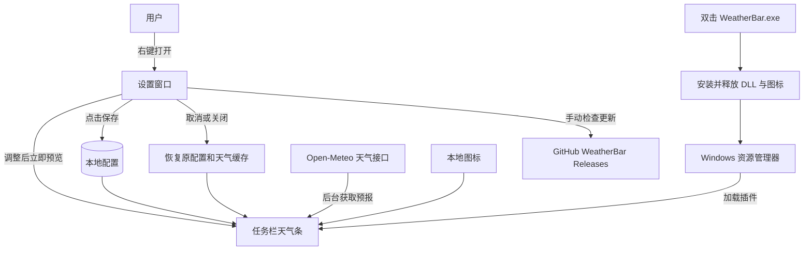

# WeatherBar 架构

任务栏组件由资源管理器加载。设置预览只影响内存，保存才原子写入配置；取消同时恢复配置及天气缓存。后台请求带代次，切换地点后不会把过期结果覆盖到新地点。

- `src/DeskBand.*`：任务栏显示、资源复用、预览快照和还原。
- `src/Settings.cpp`：多语言布局、调色盘、即时预览和保存/取消。
- `src/ImportConfig.*`：XML 配置、字段默认值、旧版本迁移及写入保护。
- `src/Weather.*`：天气获取、解析、缓存和调度。
- `src/Update.*`：手动检查正式版本，不自动下载。
- `launcher/`：单 EXE 打包、当前用户安装和安全卸载。
- `tests/`：直接验证正式实现的回归测试，无第三方测试框架。

沿用现有原生 Win32/COM 和 v145 工程，不引入主题系统、地理数据库、城市搜索或浏览器 UI 框架。目录只保留参与构建的工程；构建产物、个人配置、调试缓存和历史过程报告不提交。
